# SalatSign & SalatSchedule — Offline Android TV Prayer Times & Mosque Signage

[-emerald.svg)](https://android.com)
[-blue.svg)](https://developer.android.com)
[](https://developer.android.com/tv/compose)
[](https://github.com/batoulapps/adhan-java)

This multi-module monorepo builds **two separate, offline-first Android TV applications** sharing a common astronomical prayer engine (`:core`) and 10-foot Compose TV design system (`:core-tv-ui`):

| App | Package | Audience | Audio & Notifications | Screensaver | Phone Controller |
| :--- | :--- | :--- | :--- | :--- | :--- |
| **SalatSign** (`:app-salatsign`) | `com.salatsign.tv` | Mosques, musallas & Islamic centres | **Strictly silent** (zero audio/notification permissions) | Foreground kiosk (`FLAG_KEEP_SCREEN_ON`) | **Yes** — browser-based LAN controller & Multi-TV sync |
| **SalatSchedule** (`:app-salatschedule`) | `com.salatschedule.tv` | Households & living rooms | Optional 15-min reminders & per-prayer Adhan audio | **Yes** — Android TV `DreamService` (3 silent slides) | No (TV remote only; zero `INTERNET` permission) |

---

## 🕌 SalatSchedule (`com.salatschedule.tv`)

An interactive, 100% offline Android TV prayer timetable and screensaver designed for homes and living rooms.

- **Offline Astronomical Prayer Engine & Dual Calendar:** Computes daily Fajr, Sunrise, Dhuhr, Asr, Maghrib, and Isha offline (`com.batoulapps.adhan`) with full DST handling, simultaneous Gregorian and Hijri dates, Maghrib or midnight rollover, and configurable `-2` to `+2` day Hijri offsets.
- **Center Spotlight, Live Countdown & D-Pad Browsing:** Displays the active/next prayer (with optional Arabic name) alongside a large live countdown (`HH:MM:SS`) and `"until <Next Prayer>"` indicator. In both the main timetable row and the screensaver Prayer Schedule slide, the highlighted prayer card is the **current active prayer** (with no card highlighted between Sunrise and Dhuhr). Browse past and future dates with Left/Right D-pad keys and return instantly with the **Today** shortcut.
- **Prayer-Time Alert Banner (5 min):** Highlights the active prayer for 5 minutes when prayer time arrives with a glowing visual banner featuring Surah An-Nisa' 4:103.
- **Custom Adhan Playback, Built-In Beep-Beep & 15-Minute Reminders:** Ships silent by default (no unlicensed third-party recordings bundled). Choose the built-in **Beep-Beep** alert or import custom `.mp3`, `.wav`, `.m4a`, or `.ogg` Adhan recordings from USB or local TV storage per prayer, and test them directly in Settings with **Test Adhan Audio** (Play / Pause / Stop). Playback uses `AudioAttributes.USAGE_MEDIA` with `AUDIOFOCUS_GAIN_TRANSIENT` so it pauses other media apps and follows your TV remote's volume (note: if the TV itself is muted, Adhan audio will also be silent). Includes optional 15-minute pre-prayer heads-up notifications.
- **Android TV Screensaver (`DreamService`):** Strictly silent, dark-mode screensaver that rotates up to three slides while your TV is idle: **Prayer Schedule** (minute-only clock), **Islamic Calendar**, and **Quran Verses** (63 curated offline verses). Shifts content slightly (`≤ 8 px`) every minute to protect panels from burn-in and closes immediately on any key press.
  - **How to enable:** Open **TV Settings → Device Preferences → Screen saver → Screen saver → SalatSchedule** (or use **SalatSchedule → Settings → Screensaver → How to Set as Screensaver**). On newer Google TV devices that hide third-party screensavers, enable once via ADB (`adb shell settings put secure screensaver_components com.salatschedule.tv/com.salatschedule.tv.screensaver.SalatScreensaverService && adb shell settings put secure screensaver_enabled 1`). Stock Amazon Fire TV firmware does not launch third-party `DreamService` screensavers on idle (the in-app **Preview Screensaver** still works). See [docs/SCREENSAVER.md](docs/SCREENSAVER.md) for full details.
- **Islamic Calendar & Curated Offline Quran Verses:** Includes a ±3-year navigable Islamic Calendar (16 major Hijri dates) and 63 curated offline Quran verses (Arabic Uthmani text from [Tanzil.net](https://tanzil.net), English translation by Saheeh International, Indonesian translation by Kementerian Agama RI; see [docs/QURAN_DATA.md](docs/QURAN_DATA.md)).
- **Themes & Languages:** Dark, Light, and Auto Day/Night themes; English (`en-AU`), Indonesian (`id`), and Arabic (`ar` with Latin digits).

### SalatSchedule Screenshots

| | |
| :---: | :---: |
| 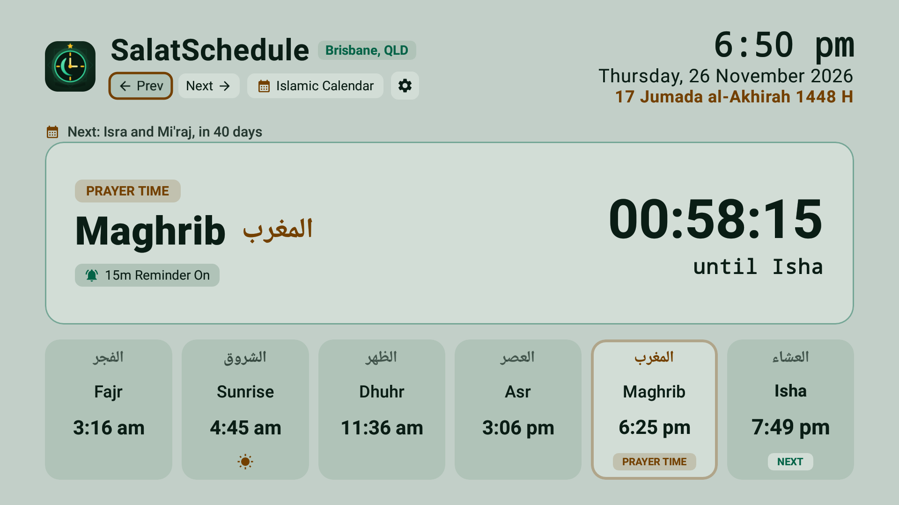 | 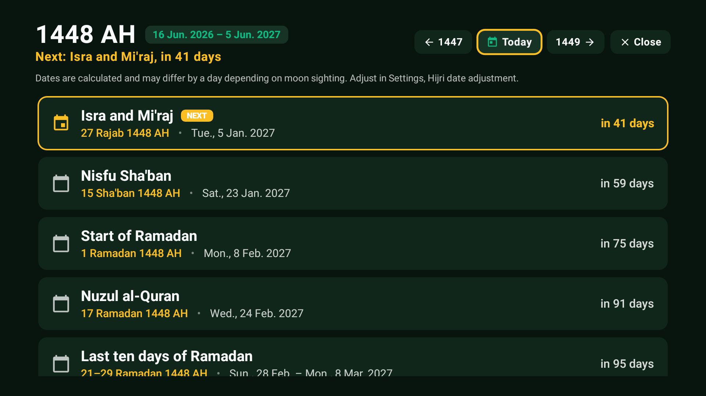 |
| *Main Prayer Schedule & Countdown* | *Islamic Calendar* |
| 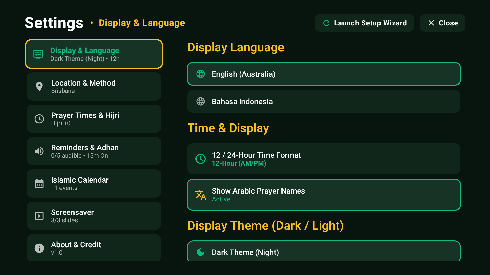 | 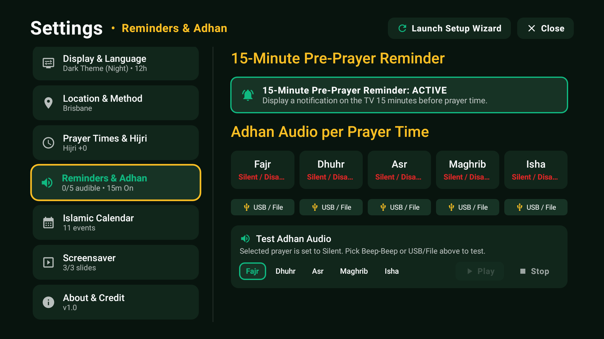 |
| *Settings Overview* | *Adhan & 15-Min Reminder Settings* |
| 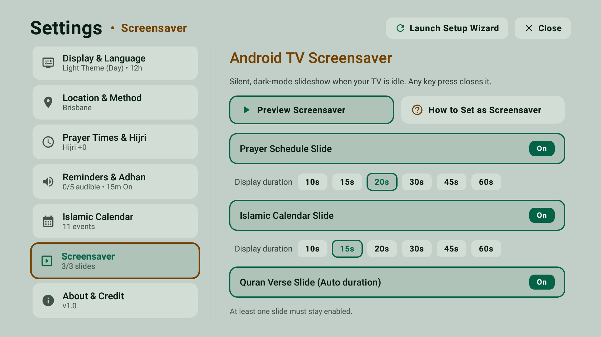 | 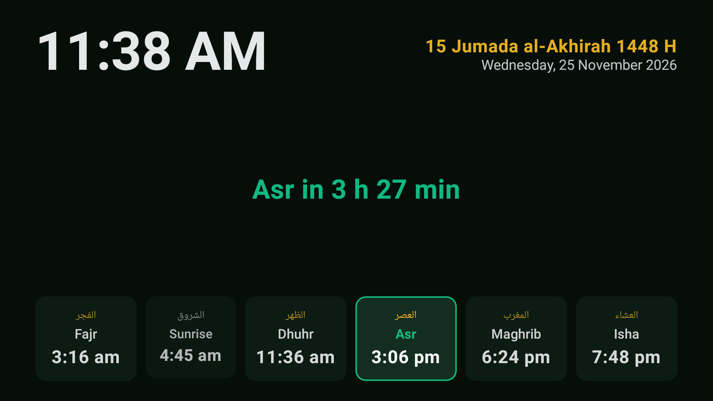 |
| *Screensaver Settings* | *Screensaver: Prayer Schedule* |
| 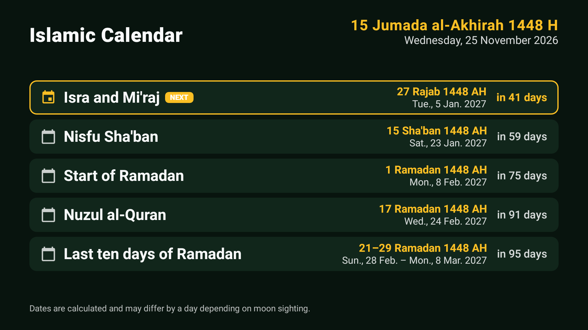 | 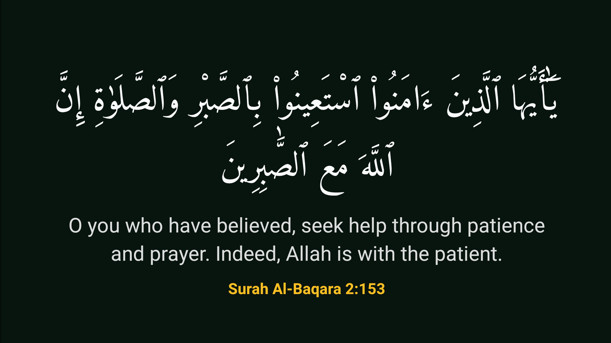 |
| *Screensaver: Islamic Calendar* | *Screensaver: Offline Quran Verse* |

---

## 📺 SalatSign (`com.salatsign.tv`)

A **strictly silent**, white-label digital signage kiosk engineered for mosques, musallas, and Islamic centres.

- **Complete White-Label Branding:** Displays only your custom **Mosque Name**, **Subtitle/Tagline**, and **Mosque Logo** (imported from USB/TV storage or uploaded from a phone) with zero app branding on the live display.
- **Jumu'ah Sittings & Iqamah Display:** Configure 1 to 3 Friday Jumu'ah sittings (fixed clock time or minutes after Dhuhr, validated across 53 Fridays including DST transitions) and per-prayer Iqamah offsets.
- **Announcement, QR Code & Built-In Slideshow:** Rotates smoothly between the Prayer Schedule (`T_schedule`, default 60s) and up to 6 active slides: formatted multi-row text announcements (with per-row alignment, font size, and offline `qrc:` QR code rows), image posters, built-in **Islamic Calendar**, and **63 Offline Quran Verses**.
- **Strictly Silent Visual Alerts, Silent Screen & Urgent Notice:**
  - **Prayer-Time Alert Banner:** Pauses slides for 5 minutes when prayer time arrives with a glowing visual banner featuring Surah An-Nisa' 4:103 and **zero sound**.
  - **Silent Screen:** Calm near-black display (`"Jumu'ah in progress"` / `"Prayer in progress"`) with minute-by-minute burn-in pixel shift during scheduled prayer windows or manual 15/30/45-minute overrides.
  - **Urgent Notice:** Full-screen high-contrast visual alert card (presets or custom text) with mandatory automatic expiry (`Clears in M:SS` countdown in English, Indonesian, and Arabic) that yields to Silent Screen during active prayer.
- **Kiosk Protection, Admin PIN & Always-On:**
  - `FLAG_KEEP_SCREEN_ON` keeps the TV awake continuously; remote `Back` is intercepted to prevent accidental exit.
  - Optional **Always-On** toggle auto-launches SalatSign on TV boot (`RECEIVE_BOOT_COMPLETED`, zero foreground service or notification permissions). *Note: Android 10+ / Google TV firmware may block background `startActivity` on boot unless "Display over other apps" is granted or a TV kiosk launcher is used; the Phone Controller HTTP server still starts automatically in-process.*
  - Hidden Admin Access (`KEYCODE_MENU` or 3-second `DPAD_CENTER` hold) gated behind a PBKDF2-salted Admin PIN (auto-upgraded to `120,000` iterations, persisted progressive lockout, 2-minute inactivity auto-close).
  - **PIN Recovery Policy:** There is deliberately no network backdoor or cloud recovery. If the admin PIN is forgotten, reset it by clearing app data via TV settings: `Android TV Settings → Apps → SalatSign → Clear data`, which restores the default PIN (`0000`).

### SalatSign Screenshots

| | |
| :---: | :---: |
| 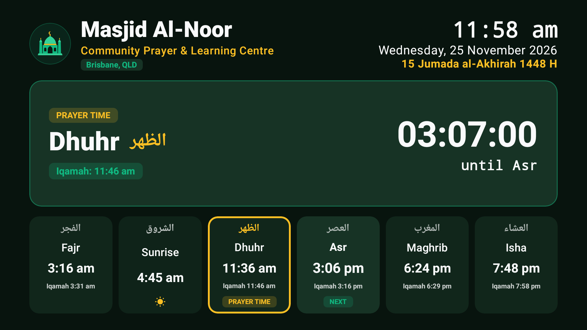 | 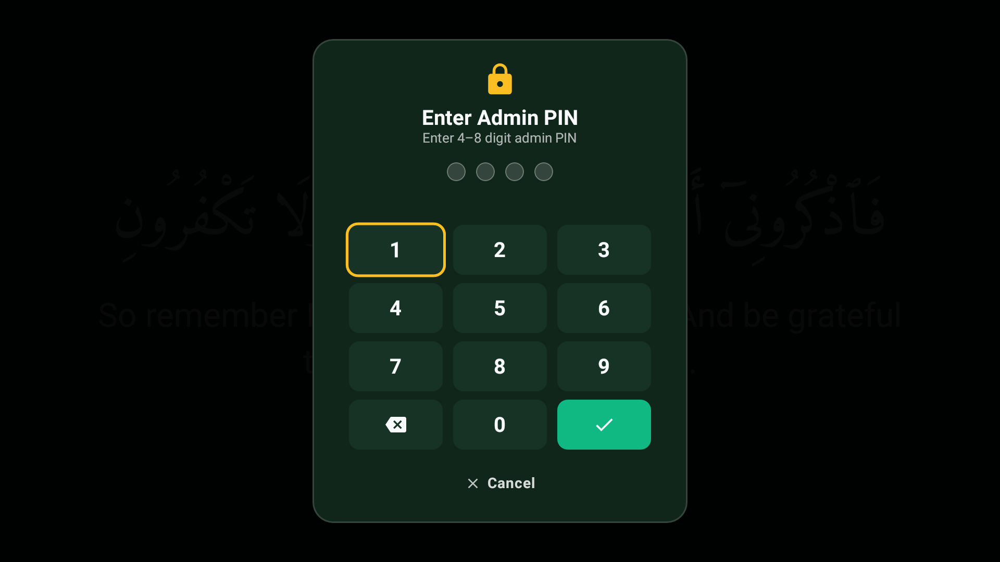 |
| *White-Label Mosque Prayer Schedule* | *Admin PIN Protection* |
| 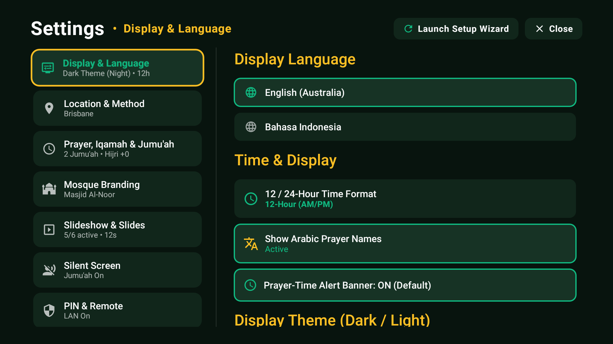 |  |
| *Mosque Admin Settings* | *Built-In Islamic Calendar Slide* |
|  | 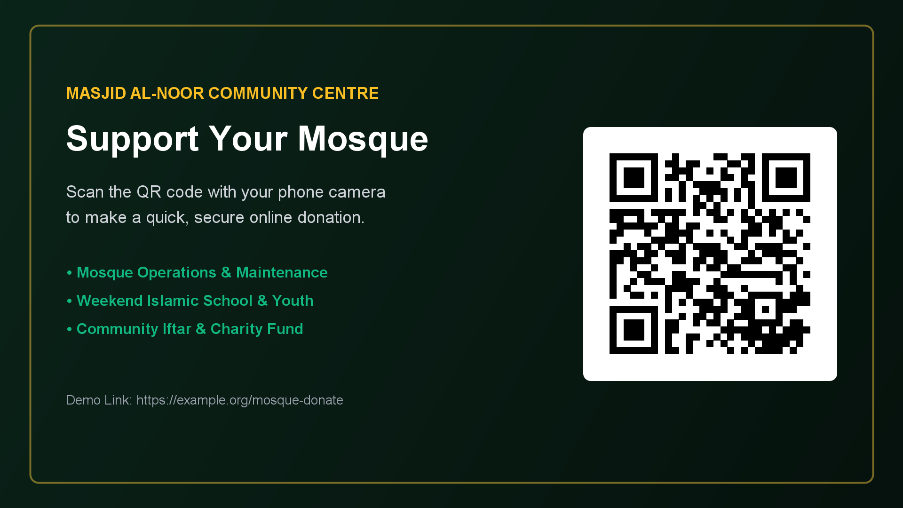 |
| *Offline Quran Verse Slide* | *Donation QR Image Slide (Demo)* |
| 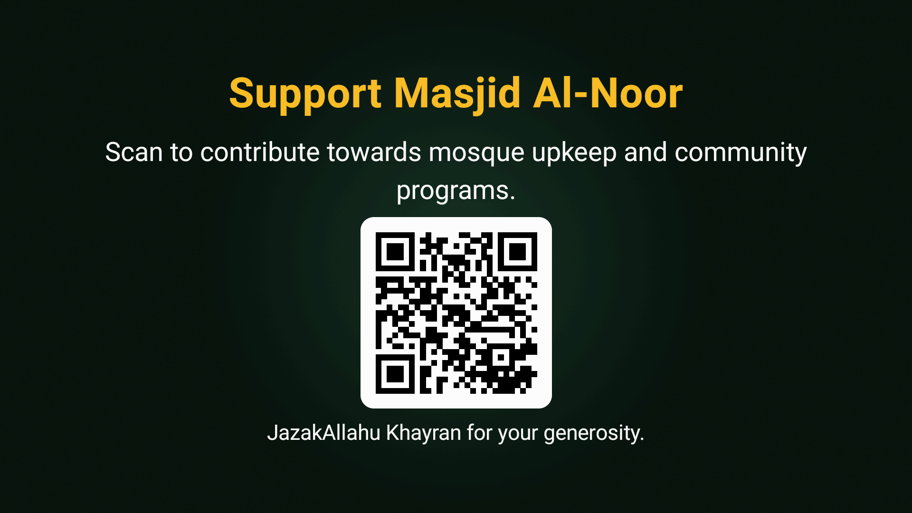 | 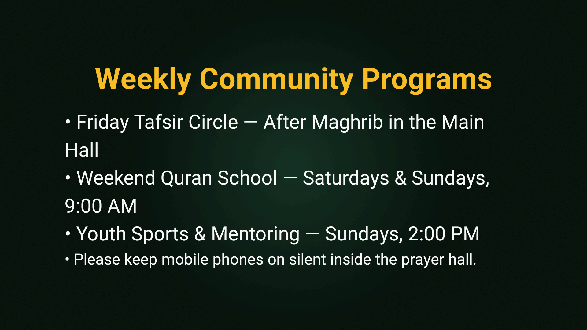 |
| *Text Slide with Inline `qrc:` QR Code* | *Formatted Text Announcement Slide* |
| 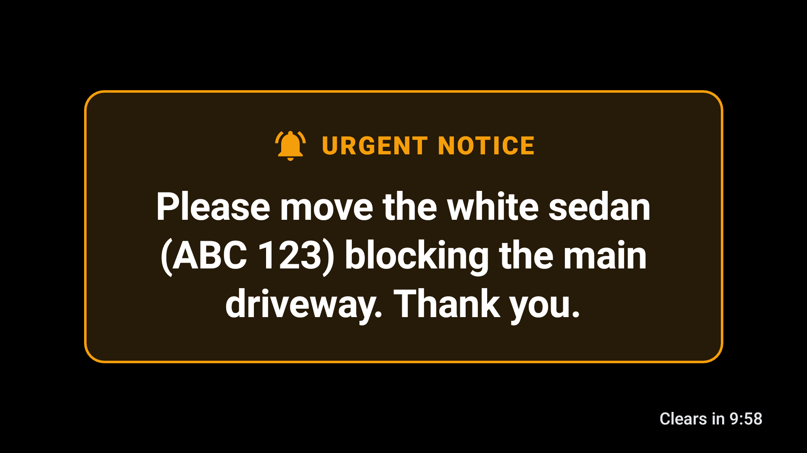 | 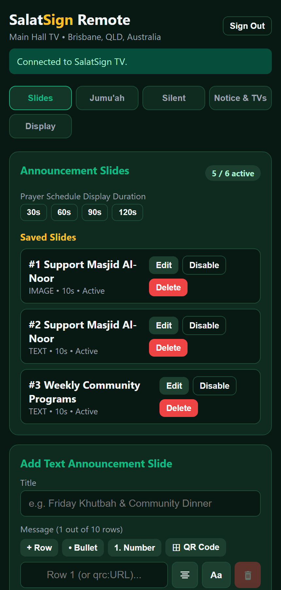 |
| *Full-Screen Urgent Notice* | *Browser-Based Phone Controller* |

---

## 📱 Phone Controller (SalatSign)

SalatSign includes a built-in **browser-based LAN Phone Controller** hosted directly on the TV—no companion app to install, works on Android, iPhone, iPad, and laptops on the mosque Wi-Fi:

- **QR / 6-Digit Browser Pairing:** Open **Settings → PIN & Remote → Pair Phone** on the TV and scan the QR code (or enter the one-time 6-digit code) in your phone browser. Supports **Manage** (full admin) and **Notify** (Urgent Notices only) roles, editable phone names, optional inactivity auto-expiry, and instant revocation synced across linked TVs.
- **Multi-TV Groups & Wall-Clock Slideshow Sync:** Link multiple TVs in the same mosque using a single-use 8-character join code to push settings, slides, images, and Urgent Notices (to All TVs or specific Room Groups) with per-TV sync/drift and clock-skew indicators. Multiple TVs transition slides together within ~1 second using pure offline wall-clock scheduling (`epochSeconds % totalCycleSeconds`, Decision D25) with zero LAN heartbeats (requires automatic date & time enabled on every TV; the Phone Controller warns if clock skew exceeds 2 seconds).
- **Security Notes:** The web UI is served over plain HTTP strictly on your local mosque LAN (with strict CSP `script-src 'self'; style-src 'self'` and Host-header validation). Browser tokens are stored SHA-256 hashed on the TV with instant revocation, join handshakes use PBKDF2-HMAC code proofs + ephemeral ECDH (P-256) + AES-256-GCM (never sending the join code or group secret in cleartext), TV-to-TV requests and responses are HMAC-SHA256 authenticated, and secret rotation is ECIES-encrypted to each remaining TV's pinned EC public key. See [docs/PHONE_CONTROLLER_PLAN.md](docs/PHONE_CONTROLLER_PLAN.md) for the full design.

---

## 🛠️ Tech Stack & Multi-Module Architecture

- **Language:** Kotlin 100% (Coroutines + Flow + `kotlinx.serialization`)
- **Minimum SDK:** API 26 (Android 8.0 Oreo) | **Target SDK:** API 35 (Android 15)
- **UI Framework:** Jetpack Compose for TV (`androidx.tv:tv-foundation`, `androidx.tv:tv-material`)
- **Prayer Engine:** `com.batoulapps.adhan:adhan` | **Hijri Engine:** `java.time.chrono.HijrahDate`
- **Storage & Images:** `androidx.datastore:datastore-preferences`, `io.coil-kt.coil3:coil-compose`, offline `com.google.zxing:core` QR encoding
- **Offline First & Network:** Core prayer calculations, Hijri calendar, Quran verses, Adhan audio, and signage slideshows work 100% offline. `:app-salatschedule` declares **zero** `INTERNET` permission; `:app-salatsign` declares `INTERNET` exclusively for the local LAN Phone Controller and Multi-TV group sync.

```text
salat-sign-schedule/
├── core/                                    # Shared library (com.salatsign.core)
│   └── PrayerCalculationEngine, HijriCalendarEngine, JumuahCalculator,
│       WallClockSlideshowScheduler, PinHasher, PairingManager, PeerHmacAuth,
│       PeerJoinCrypto, PhoneControllerApiModels, SettingsRepository, ContentRepository
├── core-tv-ui/                              # Shared Compose TV UI (com.salatsign.core.tv)
│   └── SalatSignTheme, TvTypography, LiveClockHeader, PrayerCardsRow,
│       SharedQuranVerseSlide, SharedIslamicCalendarSlide, TvEditableTextField,
│       bundled Amiri Quran font & 63-verse JSON assets, shared strings (EN/ID/AR)
├── app-salatsign/                           # SalatSign TV app (com.salatsign.tv)
│   └── Strictly silent mosque signage (MosqueSignageScreen, UrgentNoticeScreen,
│       SilentScreen, SalatSignLocalServer, PeerSyncClient, SalatSignNsdHelper,
│       SalatSignBootReceiver, PairPhoneDialog, assets/phone_controller/)
├── app-salatschedule/                       # SalatSchedule TV app (com.salatschedule.tv)
│   └── Home prayer times & screensaver (HomeScreen, SalatScreensaverService,
│       ScreensaverContent, AdhanPlaybackService, PrayerAlarmScheduler,
│       BootAndTimeReceiver, DailyScheduleWorker)
└── docs/
    ├── DECISIONS.md                         # Confirmed architectural decisions (D1–D25)
    ├── PHONE_CONTROLLER_PLAN.md             # Web Phone Controller & Multi-TV Sync plan
    ├── SCREENSAVER.md                       # SalatSchedule Android TV screensaver guide
    ├── QURAN_DATA.md                        # Offline 63-verse Quran data & attribution
    ├── salatsign/STORE_LISTING.md           # SalatSign Google Play TV listing
    └── salatschedule/STORE_LISTING.md       # SalatSchedule Google Play TV listing
```

---

## 🧪 Running Unit Tests & Building

```powershell
# Run all unit tests
./gradlew testDebugUnitTest

# Build debug APKs
./gradlew :app-salatsign:assembleDebug :app-salatschedule:assembleDebug

# Build release Android App Bundles (.aab)
./gradlew :app-salatsign:bundleRelease :app-salatschedule:bundleRelease
```

For Google Play release builds, provide per-app release keystores via environment variables or Gradle properties (`SALATSIGN_STORE_FILE`, `SALATSIGN_STORE_PASSWORD`, `SALATSIGN_KEY_ALIAS`, `SALATSIGN_KEY_PASSWORD`, and matching `SALATSCHEDULE_*` variables).

---

## License

SalatSign and SalatSchedule are free software: you can redistribute them and/or modify them under the terms of the GNU General Public License, version 3 or (at your option) any later version. See [LICENSE](LICENSE).

Copyright (C) 2026 Rocky Adam Tauhid and SalatSign contributors.

The name "SalatSign" and the logo are not covered by this license; see [TRADEMARKS.md](TRADEMARKS.md). Third-party libraries, fonts, and audio credits are listed in [docs/THIRD_PARTY.md](docs/THIRD_PARTY.md) and [docs/AUDIO_SOURCES.md](docs/AUDIO_SOURCES.md).
